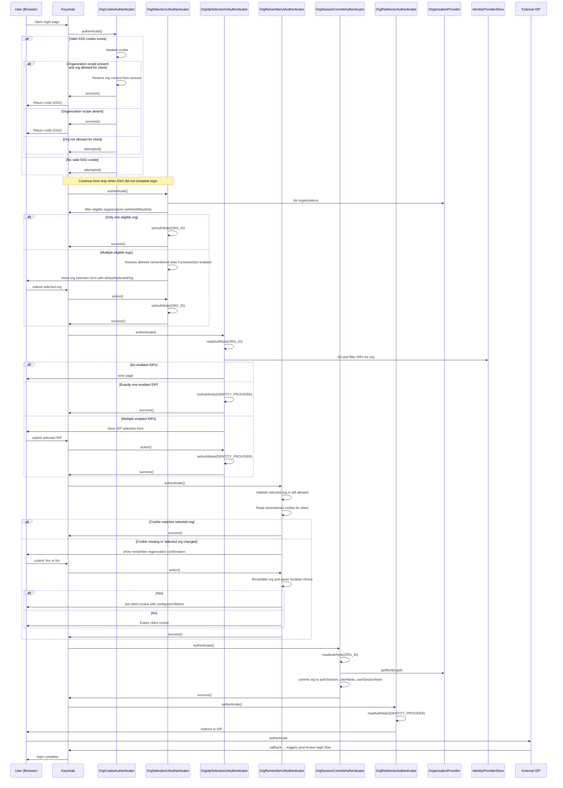

# Authentication Flow: flais-browser

[Back: Authentication Flows](README.md)

This document describes the Keycloak Authentication Flow **flais-browser**.

This flow is the entry point for browser-based login.

## Flow type

- **Type:** Browser Login
- **Trigger:** User login via HTTP (Browser)

## Top-level executions

| Step / Subflow                | Type           | Requirement | Notes                                      |
| ----------------------------- | -------------- | ----------- | ------------------------------------------ |
| FLAIS Organization SSO Cookie | execution      | Alternative | Custom SSO cookie check with org awareness |
| flais-browser - Organization  | flow (subflow) | Alternative | Custom org/idp selection chain             |

## Subflow: flais-browser - Organization

Executions (in order):

| Step                                            | Requirement | Purpose                                                        |
| ----------------------------------------------- | ----------- | -------------------------------------------------------------- |
| FLAIS Organization Selection                    | Required    | Select eligible organization (auto-select if only one)         |
| FLAIS Organization Identity Provider Selection  | Required    | Determine eligible IDPs for org (prompt if multiple)           |
| FLAIS Remember Organization Confirmation        | Required    | Remember or forget the selected org for this client            |
| FLAIS Organization Session Commit               | Required    | Commit selected org into session, auth notes, and client notes |
| FLAIS Organization Identity Provider Redirector | Required    | Redirect to chosen IDP                                         |

## Configuration

Configure execution settings under **Authentication → Flows**.
The SSO cookie, IDP selection, session commit, and redirect executions have no
custom settings.

### FLAIS Organization Selection

| Setting                           | Key                         | Default | Purpose                                                          |
| --------------------------------- | --------------------------- | ------- | ---------------------------------------------------------------- |
| Preselect remembered organization | `useRememberedOrganization` | `true`  | Preselect a remembered organization still allowed for the client |

This setting does not change the remember confirmation execution.

### FLAIS Remember Organization Confirmation

| Setting                               | Key                | Default | Purpose                                       |
| ------------------------------------- | ------------------ | ------- | --------------------------------------------- |
| Remember organization lifetime (days) | `cookieMaxAgeDays` | `30`    | Lifetime of the saved organization preference |

Accepts positive whole days from `1` to `24855`.

### Notes

- Remember confirmation runs after IDP selection and before session commit.
- A matching remembered organization skips confirmation. Otherwise, Yes saves the selection and No clears it.
- Preferences are separate for each client and must still satisfy the client's organization permissions.
- Successful SSO skips the organization subflow, including remember confirmation.

## Execution sequence

The sequence diagram below illustrates how Keycloak executes
the `flais-browser` authentication flow using custom authenticators.

